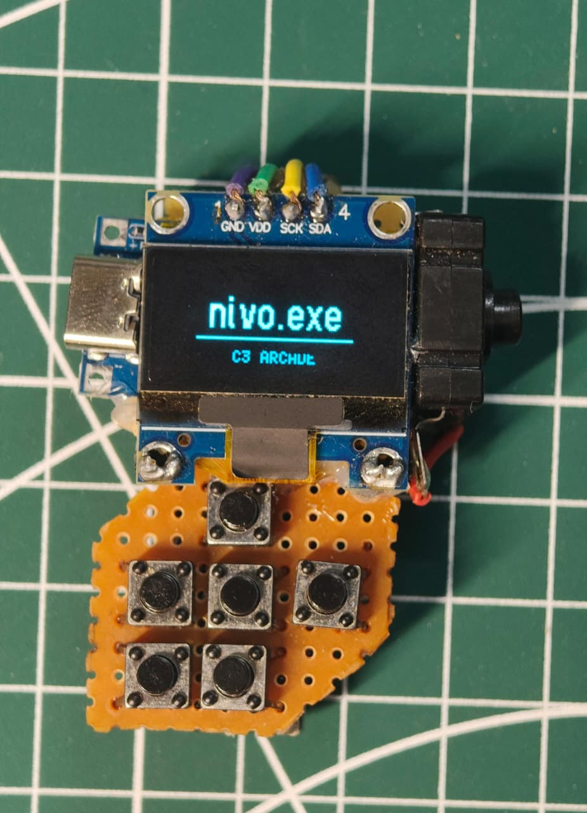

# nivo.exe — Handheld Console V1


A compact, DIY handheld gaming console and pocket engineering workstation powered by the **ESP32-C3 SuperMini** (RISC-V). Running custom bare-metal C++ firmware on top of the **U8g2** library, **nivo.exe** achieves full 50–60 FPS graphics over high-speed 1.0&nbsp;MHz I2C, featuring a 3D raycasting engine, pseudo-3D flight and racing simulators, 21 playable arcade games, and a full suite of 24 offline engineering tools and hardware diagnostics.

---

## Visual Showcase

<div align="center">
  
  <p><em>nivo.exe (Handheld Console V1) running on the ESP32-C3 SuperMini with 0.96″ I2C OLED and 6-button tactile keypad</em></p>
</div>

<div align="center">
  <table align="center">
    <tr>
      <td align="center">
        <br />
        <b>Game Launcher (58 FPS)</b>
      </td>
      <td align="center">
        <br />
        <b>Angled Ergonomic Layout</b>
      </td>
      <td align="center">
        <br />
        <b>Compact Sandwich Profile</b>
      </td>
    </tr>
  </table>
</div>

---

## Key Highlights

- **Custom High-Speed Graphics Engine**: Operates at 1.0&nbsp;MHz I2C bus speeds with direct framebuffer manipulation (`u8g2.getBufferPtr()`) and column-span pattern streaming, delivering true 50–60 FPS updates.
- **21 Complete Arcade & 3D Games**: Raycaster FPS (Doom-lite), OutRun pseudo-3D racer, 3D aerial flight simulator, 3D maze, classic arcade ports (Tetris, Pong, Snake, Breakout, Lunar Lander, Space Invaders, Asteroids, Pac-Man, Donkey Kong, etc.).
- **24 Pocket Engineering Utilities**: Standalone tools including a 2.4&nbsp;GHz Wi-Fi scanner, I2C bus sniffer, 4-band/5-band resistor decoder, interactive periodic table with Bohr atomic shells, scientific calculator, metronome, logic gate lab, and hardware diagnostics.
- **Instant Universal Menu Escape**: Hold **A + B** simultaneously for ~0.8 seconds inside any game or app to smoothly return to the launcher with an on-screen progress indicator bar.
- **Non-Volatile High-Score Persistence**: Uses ESP32 `Preferences` NVS storage to record best times and top scores across power cycles.
- **LiPo Battery Power Architecture**: Integrated TP4056 charging module with a hardware-modified PROG resistor for safe 176&nbsp;mA charging, paired with an ultra-efficient 5V boost converter.

---

## Hardware Specifications & Bill of Materials

| Part | Qty | Specifications & Implementation Notes |
| :--- | :---: | :--- |
| **ESP32-C3 SuperMini** | 1 | 32-bit RISC-V single-core @ 160&nbsp;MHz, 400&nbsp;KB SRAM, 4&nbsp;MB Flash, onboard USB-C (USB CDC on boot) |
| **0.96″ Monochrome OLED** | 1 | 128×64 resolution, SSD1306 driver, 4-pin I2C interface (VCC, GND, SCL, SDA), 3.3V logic |
| **LiPo Battery** | 1 | 3.7V nominal (4.2V peak) 400&nbsp;mAh single-cell pouch pack |
| **TP4056 Charger Module** | 1 | 5V USB-C input linear lithium charger with integrated DW01A/8205A battery protection |
| **5V Step-Up Boost Converter** | 1 | DC-DC boost module raising battery voltage (3.0V–4.2V) to 5.0V for the SuperMini 5V input rail |
| **PROG Tuning Resistor** | 1 | **6.8&nbsp;kΩ** SMD/through-hole resistor (replaces default 1.2&nbsp;kΩ to set safe charge current to ~176&nbsp;mA) |
| **Tactile Push Buttons** | 6 | 6×6×5&nbsp;mm momentary tactile pushbuttons (UP, DOWN, LEFT, RIGHT, A, B) |
| **Passive Piezo Buzzer** | 1 | Small passive piezo transducer driven directly by ESP32 LEDC hardware PWM |
| **Power Slide Switch** | 1 | SPST miniature slide switch placed in the load path between battery/TP4056 and boost converter |
| **Perfboard & Hardware** | — | Cut protoboard / perfboard, silicone 30&nbsp;AWG hookup wire, hot-melt adhesive / kapton tape insulation |

---

## GPIO Assignment & Wiring Pinout

All 6 buttons are wired directly between their designated GPIO and **GND**, utilizing internal pull-ups (`INPUT_PULLUP`). When released, the pin reads `HIGH`; when pressed, it reads `LOW`. All buttons share a common ground bus.

<div align="center">

| Function | ESP32-C3 GPIO | Physical Connection | Wiring Notes |
| :--- | :---: | :--- | :--- |
| **UP Button** | `GPIO 0` | Button Pin $\to$ `GND` | Directional D-pad Up |
| **DOWN Button** | `GPIO 1` | Button Pin $\to$ `GND` | Directional D-pad Down |
| **LEFT Button** | `GPIO 3` | Button Pin $\to$ `GND` | Directional D-pad Left |
| **RIGHT Button** | `GPIO 4` | Button Pin $\to$ `GND` | Directional D-pad Right |
| **FRONT / A Button** | `GPIO 5` | Button Pin $\to$ `GND` | Primary action / Select / Fire |
| **BACK / B Button** | `GPIO 6` | Button Pin $\to$ `GND` | Secondary action / Cancel / Exit |
| **Passive Buzzer** | `GPIO 7` | Piezo $(+)$ $\to$ `GPIO 7`, $(-)$ $\to$ `GND` | Low-current passive piezo transducer (LEDC PWM) |
| **OLED SDA** | `GPIO 8` | OLED `SDA` $\to$ `GPIO 8` | I2C Data line (hardware pull-up) |
| **OLED SCL** | `GPIO 9` | OLED `SCL` $\to$ `GPIO 9` | I2C Clock line (hardware pull-up) |
| **OLED VCC** | `3V3` | OLED `VCC` $\to$ SuperMini `3V3` | 3.3V clean regulated supply rail |
| **OLED GND** | `GND` | OLED `GND` $\to$ SuperMini `GND` | Common system ground |

</div>

> [!WARNING]
> **Boot-Pin Strapping Caution (GPIO 8 & GPIO 9)**:
> `GPIO 8` and `GPIO 9` are ESP32-C3 hardware strapping pins controlling boot mode logic levels. The attached I2C OLED display lines have pull-up resistors that can affect startup timing during cold reset. Test cold boots and USB programming with the OLED connected. If flashing fails, hold the BOOT button on the SuperMini during reset.

---

## Power Subsystem & Battery Management

The console incorporates a two-stage battery and power path architecture:

```
 [ USB-C (5V) ]
       │
       ▼
 ┌───────────────┐        ┌───────────────────┐
 │ TP4056 Linear │───────▶│ 3.7V 400mAh LiPo  │
 │ Charger (PROG)│◀───────│ Battery Cell      │
 └───────┬───────┘        └───────────────────┘
         │ (Protected OUT+ / OUT-)
         ▼
 ┌───────────────┐
 │ Power Switch  │
 └───────┬───────┘
         ▼
 ┌───────────────┐
 │ 5V Step-Up    │
 │ Boost Conv.   │ (Adjusted strictly to 5.0V)
 └───────┬───────┘
         │ (OUT+ 5V / OUT- GND)
         ▼
 ┌────────────────────────┐
 │ ESP32-C3 SuperMini     │
 │ 5V Pin (Onboard 3.3V)  │
 └────────────────────────┘
```

<div align="center">
  
  <p><em>Backside assembly showing perfboard wiring, boost converter, ESP32-C3 SuperMini, buzzer, and battery stack</em></p>
</div>

### 1. TP4056 PROG Resistor & Charge Current Tuning
The factory configuration of most TP4056 modules includes a $1.2\text{ k}\Omega$ programming resistor ($R_{\text{PROG}}$), setting charge current to $1000\text{ mA}$. Charging a compact $400\text{ mAh}$ pouch cell at $1000\text{ mA}$ ($2.5\text{C}$) leads to severe overheating and cell degradation.

The charge current is calculated using:
$$I_{\text{CHG}}\text{ (mA)} \approx \frac{1200}{R_{\text{PROG}}\text{ (k}\Omega\text{)}}$$

| $R_{\text{PROG}}$ Resistor | Approx. Charge Current | Suitability for 400&nbsp;mAh Cell |
| :---: | :---: | :--- |
| $1.2\text{ k}\Omega$ (Default) | $1000\text{ mA}$ | **Dangerous**: Exceeds maximum cell charge limits |
| $2.4\text{ k}\Omega$ | $500\text{ mA}$ | High ($1.25\text{C}$) |
| $5.0\text{ k}\Omega$ | $240\text{ mA}$ | Acceptable ($0.6\text{C}$) |
| **$6.8\text{ k}\Omega$ (Installed)** | **$176\text{ mA}$** | **Optimal (~0.44C safe charging for 400&nbsp;mAh cell)** |
| $10.0\text{ k}\Omega$ | $120\text{ mA}$ | Very conservative / trickle charging |

By soldering a **$6.8\text{ k}\Omega$** resistor in place of the stock resistor on the TP4056, the charge rate is locked to a safe and cool **$176\text{ mA}$**.

### 2. Boost Converter Calibration
- The boost converter lifts the LiPo's fluctuating $3.0\text{V} - 4.2\text{V}$ voltage to a steady **$5.0\text{V}$**, fed into the SuperMini's `5V` pin (which routes through the onboard LDO to supply the chip with clean 3.3V).
- **CRITICAL STEP**: Before connecting the boost output to the ESP32-C3, connect the battery, power the boost converter, and measure the output with a digital multimeter. Turn the potentiometer until the output reads **5.0V**. Never feed 5V into the `3V3` pin.

### 3. Critical Safety Operating Rules
1. **Never Charge While Playing**: The standard TP4056 is not a load-sharing power-path controller. Running the console while charging alters termination currents and can prevent proper charge cutoff. Keep the slide switch **OFF** while charging via USB.
2. **Prevent Dual 5V Back-Feeding**: When connecting the ESP32-C3 SuperMini's onboard USB-C port to a computer for firmware flashing or serial debugging, ensure the boost converter slide switch is turned **OFF** to avoid power contention between USB power and the boost converter rail.

---

## Assembly Sequence & Inspection Checklist

### 10-Step Assembly Sequence
1. **Module Inspection**: Inspect board revisions and check pin labels for both the ESP32-C3 SuperMini and OLED.
2. **Pre-Assembly ESP32 Test**: Plug the SuperMini into USB and verify serial communication, boot behavior, and LED blinking.
3. **Display Test**: Wire the OLED (`3V3`, `GND`, `GPIO 8`, `GPIO 9`) and verify communication via an I2C scan sketch.
4. **Keypad Construction**: Assemble the 6 tactile buttons on perfboard with a common GND bus; verify input continuity with a multimeter.
5. **Audio Hookup**: Solder the piezo buzzer between `GPIO 7` and `GND`; verify low-volume test tones.
6. **TP4056 PROG Modification**: Locate and replace the stock PROG resistor on the TP4056 with a **$6.8\text{ k}\Omega$** resistor.
7. **Battery Connection**: Solder the LiPo battery leads to `B+` and `B-` on the TP4056 with strict attention to polarity.
8. **Boost Calibration**: Solder TP4056 `OUT+`/`OUT-` to boost converter `IN+`/`IN-` through the slide switch; power up and trim output to **$5.0\text{V}$**.
9. **Final Power Integration**: Connect boost `OUT+` to SuperMini `5V` and boost `OUT-` to `GND`. Insulate all joints with heat shrink or Kapton tape.
10. **Mechanical Stack**: Secure modules without pinching, puncturing, or mechanically stressing the LiPo battery pouch.

### Pre-Power Checklist
- [x] Battery polarity verified ($+$ to red, $-$ to black).
- [x] No solder bridges, shorts, or loose copper wire strands.
- [x] TP4056 PROG resistor verified at $6.8\text{ k}\Omega$.
- [x] Boost converter output verified with multimeter at exactly $5.0\text{V}$.
- [x] OLED pins correctly routed (`VCC` to 3.3V, `GND` to GND, `SDA` to GPIO 8, `SCL` to GPIO 9).
- [x] Buttons connected to GND and set as `INPUT_PULLUP`.
- [x] Battery pouch completely isolated from sharp solder pins and heatsinks.

---

## Software Architecture & Engine Features

```
nevo.exev1/
├── nevo.exev1.ino         # Complete multi-game and utility firmware (~7,800 lines of optimized C++)
├── c3_arcade_sprites.h    # High-density PROGMEM bitmap graphics, UI controls, item sets, and tilemaps
├── refrences/             # Visual reference sheets, sprite templates, and arcade design art
└── sprite c codes/
    ├── c3_arcade_sprites.h
    └── SPRITE_USAGE.md    # Memory optimization notes and static assertion documentation
```

### High-Performance OLED Rendering
- **1.0 MHz Hardware I2C Clock**: Overclocked I2C bus (`u8g2.setBusClock(1000000)`) pushes 1&nbsp;KB framebuffers in ~12–14&nbsp;ms, enabling sustained 50–60 FPS.
- **Direct Framebuffer Access**: Directly manipulates memory buffer pointers via `fb = u8g2.getBufferPtr()` to eliminate driver function overhead.
- **Span-Based Vertical Column Drawing (`colSpan`)**: In 3D raycasting and road rendering, vertical strips of walls and ground are written as contiguous byte patterns into the buffer rather than iterating individual pixels.
- **$4\times4$ Bayer Dithering**: Bayer matrix provides smooth pseudo-grayscale texture and distance shading on a 1-bit monochrome OLED.

### Universal Navigation & Combos
- **Menu Controls**: D-pad navigation, **A** to launch, **B** to back out of sub-menus.
- **Global Exit Combo**: Pressing and holding **A + B** simultaneously (with no directional keys pressed) for **$800\text{ ms}$** triggers a smooth return to the main menu. A dynamic horizontal progress bar renders across the top edge of the OLED during the hold.

---

## Games Catalog (21 Playable Titles)

<div align="center">
  <table align="center">
    <tr>
      <td align="center">
        <br />
        <b>3D Maze Runner (44 FPS Raycaster)</b>
      </td>
      <td align="center">
        <br />
        <b>Sky Raid 3D Flight (58 FPS)</b>
      </td>
    </tr>
    <tr>
      <td align="center">
        <br />
        <b>Racer (60 FPS OutRun-Style)</b>
      </td>
      <td align="center">
        <br />
        <b>Lunar Escape (Lander Physics)</b>
      </td>
    </tr>
  </table>
</div>

1. **DOOM-LITE**: 3D Raycasting first-person shooter. Features DDA raycasting, texture-mapped walls, Bayer light attenuation, minimap radar, ammo/health HUD, and animated enemy monsters (demons and crawlers) with AI tracking and combat.
2. **3D MAZE**: 3D raycaster labyrinth navigation engine. Solve procedurally complex mazes against a live countdown clock with high-score storage.
3. **RACER**: OutRun-inspired pseudo-3D road racer. Full perspective projection, undulating mountain horizon, scaling roadside scenery, traffic avoidance, and speedometer at 60 FPS.
4. **SNAKE**: Classic arcade Snake featuring dirty-rectangle display updates for ultra-low latency, dynamic speed scaling, and persistent high scores.
5. **PONG**: 1-player retro table tennis with reactive AI opponent paddle and acoustic buzzer bounces.
6. **BREAKOUT**: Arcade brick-breaker featuring multi-row breakable blocks, directional paddle deflection physics, and sound effects.
7. **SKY RAID**: Full 3D wireframe aerial flight simulator. Pilot a jet through floating obstacle pylons, target rings, and enemy combat drones with realistic pitch and roll projection.
8. **TETRA-DROP**: Full falling-block tetromino puzzle featuring piece rotation, drop guides, multi-line clear bonuses, and score tracking.
9. **LUNAR ESC**: Precision lunar lander. Maneuver through rugged vector terrains, balancing thruster burn and gravity to touch down safely on designated landing pads.
10. **VOID STRK**: Fast-paced vertical scrolling space shooter (shmup) with incoming enemy formations, weapon firing, and defensive maneuvering.
11. **SOKOBAN**: Classic warehouse crate-pushing puzzle requiring strategic forward planning to move blocks onto target locations.
12. **MICRO BEAT**: Rhythmic timing arcade game testing hand-eye coordination against escalating tempo cues.
13. **ARTILLERY**: Turn-based ballistic physics combat. Dial in barrel angle, projectile velocity, and wind compensation to destroy enemy fortifications.
14. **SUB-HUNTER**: Tactical naval warfare. Drop depth charges from a surface destroyer to neutralize submarines patrolling ocean depths.
15. **CRYPT ROG**: Procedurally generated turn-based roguelike dungeon crawler featuring tile-based exploration, combat stats, HP, and loot.
16. **PIXEL PLAT**: 2D side-scrolling platformer with inertia physics, jump mechanics, platforms, hazards, and enemy stomping.
17. **INVADERS**: Space Invaders recreation with marching alien squadrons, destructible bunker shields, and mystery flying saucers.
18. **PAC-CHASE**: Classic maze pursuit with dots, power pellets, and wandering ghosts.
19. **BARREL KONG**: Arcade platformer where the player scales girder structures and climbs ladders while leaping over rolling barrels.
20. **FLAPPY C3**: Gravity tap arcade game navigating a flying avatar between procedural vertical pipe obstacles.
21. **ASTEROIDS**: Vector inertia space shooter featuring 360-degree Newtonian ship rotation, thruster drift, and splitting rock hazards.

---

## Extras & Engineering Toolkit (24 Utilities)

Accessible directly from the **EXTRAS** menu icon, this suite turns the console into a pocket electronic testing bench and Swiss Army knife.

<div align="center">
  <table align="center">
    <tr>
      <td align="center">
        <br />
        <b>Scientific Keypad Calculator</b>
      </td>
      <td align="center">
        <br />
        <b>Interactive Periodic Table</b>
      </td>
      <td align="center">
        <br />
        <b>Resistor Color Code Decoder</b>
      </td>
    </tr>
    <tr>
      <td align="center">
        <br />
        <b>Metronome with Tap Tempo</b>
      </td>
      <td align="center">
        <br />
        <b>2.4 GHz Wi-Fi Sniffer</b>
      </td>
      <td align="center">
        <br />
        <b>Integrated Hardware Diagnostics</b>
      </td>
    </tr>
  </table>
</div>

| # | Utility | Description & Capabilities |
| :---: | :--- | :--- |
| **01** | **CALCULATOR** | Interactive on-screen keypad calculator with decimal precision and standard arithmetic operations. |
| **02** | **BUZZER PIANO** | Multi-octave musical synthesizer playing real audio frequencies through the piezo buzzer. |
| **03** | **CHRONO / TIMER** | Millisecond-accurate digital stopwatch and customizable countdown timer with alarm. |
| **04** | **METRONOME** | Adjustable acoustic and visual metronome (BPM selection, tap tempo, time signature indicators, animated pendulum). |
| **05** | **DICE & RNG** | Tabletop polyhedral dice simulator (D4, D6, D8, D10, D12, D20) and pseudo-random number generator. |
| **06** | **SOUNDBOARD** | 8-bit sound effects player for audio testing, alarms, and retro chiptune tones. |
| **07** | **TORCH & SOS** | Max-white high-brightness display flashlight mode with an automated Morse code SOS flashing beacon. |
| **08** | **SYSTEM INFO** | Live hardware status: CPU clock speed (160&nbsp;MHz), free heap RAM, flash chip capacity, SDK version, and uptime. |
| **09** | **BUTTON TEST** | Hardware input diagnostic displaying real-time digital states and debouncing health for all 6 switches. |
| **10** | **WIFI SCANNER** | 2.4&nbsp;GHz RF sniffer detecting nearby Wi-Fi networks, displaying SSID names, RSSI signal strength (dBm), and security encryption. |
| **11** | **REACTION TEST** | Millisecond reaction timer benchmarking reflex speeds against random visual cues. |
| **12** | **UNIT CONVERT** | Real-time engineering converter for temperature (°C/°F/K), length, mass, and digital data storage. |
| **13** | **I2C SCANNER** | Hardware bus analyzer scanning addresses `0x00` through `0x7F` to identify connected sensors and peripherals. |
| **14** | **MORSE CODE** | Visual and acoustic Morse keyer and reference translator. |
| **15** | **CIPHER & PASS** | Text cryptographic tool featuring Caesar ciphers, ROT13, and a secure random password generator. |
| **16** | **TALLY COUNTER** | Multi-channel digital counter with persistent NVS memory retention across reboots. |
| **17** | **PIXEL PAD** | 16×16 on-screen bitmap drawing canvas for sketching pixel art and icons. |
| **18** | **BREATHING ZEN** | Guided box-breathing mindfulness visualizer with animated expansion and contraction guides. |
| **19** | **LOGIC LAB** | Interactive digital logic gate simulator (AND, OR, NOT, XOR, NAND, NOR) with live truth tables. |
| **20** | **SPIRIT LEVEL** | Virtual 2-axis surface leveler. |
| **21** | **RESISTOR CODE** | 4-band and 5-band electronic resistor color code calculator with real-time graphical preview. |
| **22** | **TONE LAB** | Variable frequency audio signal generator supporting sweeps from 100&nbsp;Hz to 10&nbsp;kHz. |
| **23** | **PERIODIC TABLE** | Comprehensive chemical element database displaying atomic number, atomic mass, element name, and animated Bohr electron shell diagrams. |
| **24** | **BASE CONVERT** | Numeral radix converter translating between Binary, Octal, Decimal, and Hexadecimal in real time. |

---

## Build & Flashing Instructions

### 1. Arduino IDE Setup
1. Install **Arduino IDE 2.x** or configure **PlatformIO**.
2. Add ESP32 board support via the Boards Manager:
   ```
   https://espressif.github.io/arduino-esp32/package_esp32_index.json
   ```
3. Install the **U8g2** library by *olikraus* via the Arduino Library Manager.

### 2. Board Configuration
Under the **Tools** menu in the Arduino IDE, set the following parameters:
- **Board**: `ESP32C3 Dev Module`
- **USB CDC On Boot**: `Enabled` *(Crucial for USB serial and programming)*
- **CPU Frequency**: `160MHz (WiFi)`
- **Flash Frequency**: `80MHz`
- **Flash Mode**: `QIO` or `DIO`
- **Partition Scheme**: `Minimal SPIFFS (1.9MB APP with OTA/190KB SPIFFS)` or `Default 4MB with spiffs`
- **Upload Speed**: `921600` (or `460800` for stability)

### 3. Compilation & Flashing
1. Open [`nevo.exev1/nevo.exev1.ino`](file:///d:/github-repo-local/nivo.exe-prototype/nevo.exev1/nevo.exev1.ino).
2. Ensure [`c3_arcade_sprites.h`](file:///d:/github-repo-local/nivo.exe-prototype/nevo.exev1/c3_arcade_sprites.h) is in the same directory.
3. Connect the ESP32-C3 SuperMini via USB-C with the console's battery slide switch set to **OFF**.
4. Select the matching COM port and click **Upload**.

---

## Troubleshooting Guide

| Issue / Symptom | Root Cause | Solution |
| :--- | :--- | :--- |
| **Board will not boot or flash** | GPIO 8/9 strapping conflict or missing USB CDC driver | Unplug OLED display or hold the onboard BOOT button while plugging in USB; verify `USB CDC On Boot: Enabled`. |
| **OLED display is blank** | Incorrect wiring, supply voltage, or I2C clock rate | Verify `VCC` is on 3.3V, confirm SDA (`GPIO 8`) and SCL (`GPIO 9`), and check I2C address with the built-in I2C Scanner. Lower `I2C_SPEED` to `800000` or `400000` if display glitches. |
| **Button registers as permanently pressed** | Both wires soldered to the same internally connected pin pair | Tactile 4-pin switches connect internal pin pairs horizontally. Use a multimeter continuity test to wire across the switching gap. |
| **SuperMini resets when buzzer sounds** | Buzzer draws excessive current | Ensure a high-impedance **passive piezo** element is used. Never connect a low-impedance magnetic buzzer directly to a GPIO without a transistor driver. |
| **Boost output collapses under load** | Discharged battery or boost current limitation | Ensure LiPo voltage is $\ge 3.4\text{V}$; confirm boost module can supply $500\text{ mA}+$ peak current without dropouts. |
| **Battery gets warm while charging** | Charge current set too high | Check the TP4056 PROG resistor. Replace with a **$6.8\text{ k}\Omega$** resistor to limit current to $176\text{ mA}$. |

---

## License

This project is open-source under the MIT License. Feel free to build, modify, and expand upon the hardware and firmware designs!
